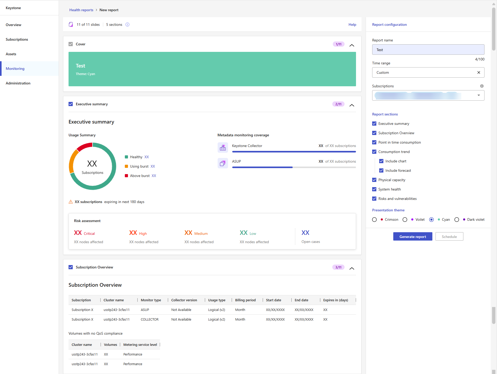
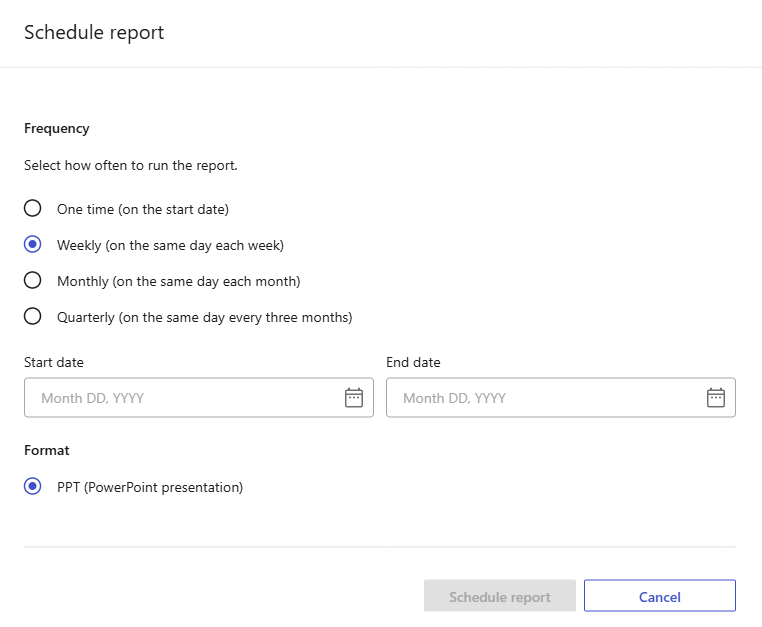

= Generate and schedule health reports for Keystone subscriptions
:hardbreaks:
:nofooter:
:icons: font
:linkattrs:
:imagesdir: ../media/

[.lead]
Generate or schedule health reports for one or more Keystone subscriptions from the Keystone dashboard in the NetApp Console. These reports provide a consolidated view of subscription usage, operational health, risks, and vulnerabilities that you can share with intended recipients. This functionality is not available in Digital Advisor.

.About this task
Health reports give you a view of subscription usage, operational health, and identified risks across the subscriptions you select. On the *New report* page, use the *Report configuration* panel to define the scope and options for the report. Use the preview area to review the slide order and layout before you generate or schedule the report. The preview shows the report structure only and does not display actual subscription data.

Follow these steps to generate a report for immediate download or to schedule a one-time or recurring report for later delivery:

.Steps
. From the Console left navigation menu, select *Storage > Keystone > Monitoring > Reports*.
. Select *New report*.
. In the *Report configuration panel*, enter a name in the *Report name* field.
. Select a time range from the *Time range* dropdown.
+
Select a preset range, such as *Last 60 days*, or select *Custom* to enter your own dates. The selected range determines the historical data shown in the *Consumption trend* section and other time-based sections. If you select *Custom*, you cannot schedule the report.
+

. Select one or more subscriptions from the *Subscriptions* dropdown.
+
NOTE: NetApp partners can select subscriptions across one or more of their managed Keystone customer accounts.
. Under *Report sections*, select the sections you want to include.
+
Each section you select appears in the preview area and is included in the generated report. For example, you can include a summary of your subscriptions, current capacity usage, consumption trends, physical capacity, system health, and risks and vulnerabilities. For *Consumption trend*, you can you can include a chart of historical consumption and, optionally, a forecast of future consumption.
. Select a presentation theme.
. Review the sections shown in the preview area to confirm that they match your selections.
. Choose how you want to create the report.
+
* *Generate report*
+
Select *Generate report* to download the report immediately.
+
The report is submitted for generation, and you are returned to the *Reports* tab. The report appears with a status of *Running*.
+
After the status changes to *Generated*, select the ellipsis icon at the end of the report's row, and then select *Download*.
+
* *Schedule report*
+
Select *Schedule* to create a one-time or recurring report, and complete the following steps:
+
.. Select a frequency: *One time*, *Weekly*, *Monthly*, or *Quarterly*.
.. Select a *Start date*.
+

+
The start date determines when the report first runs. For recurring frequencies, the report runs again according to the selected weekly, monthly, or quarterly schedule.
.. Optionally, select an *End date*.
+
If you don't select an end date, the schedule continues until you change it.
.. Select *Schedule report*.
+
The schedule is created, and the report appears on the *Reports* tab with an execution type of *Scheduled run*. Use the *Last run*, *Next run*, and *Status* columns to track each run.
+
To edit a weekly, monthly, or quarterly schedule, select the ellipsis icon at the end of the report's row, and then select *Edit schedule*. You can do this whether the status is *Scheduled* or *Generated*. You cannot edit a *One time* schedule after the report is generated.
+
After the status changes to *Generated*, select the ellipsis icon next to the report and select *Download*.

.Result
Generated reports download as PowerPoint presentations. You can select *Generate again* from the ellipsis menu to create a new report with the same configuration. 

*Related information*

* link:../integrations/dashboard-access.html[Get started with the Keystone dashboard]
* link:../integrations/subscriptions-tab.html[View details about your Keystone subscriptions]
* link:../integrations/current-usage-tab.html[View current usage]
* link:../integrations/consumption-tab.html[View consumption trends]
* link:../integrations/assets-tab.html[View assets associated with your subscriptions]
* link:../integrations/monitoring-alerts.html[View and manage alerts]
* link:../integrations/monitoring-alert-monitors.html[View and create alert monitors]
